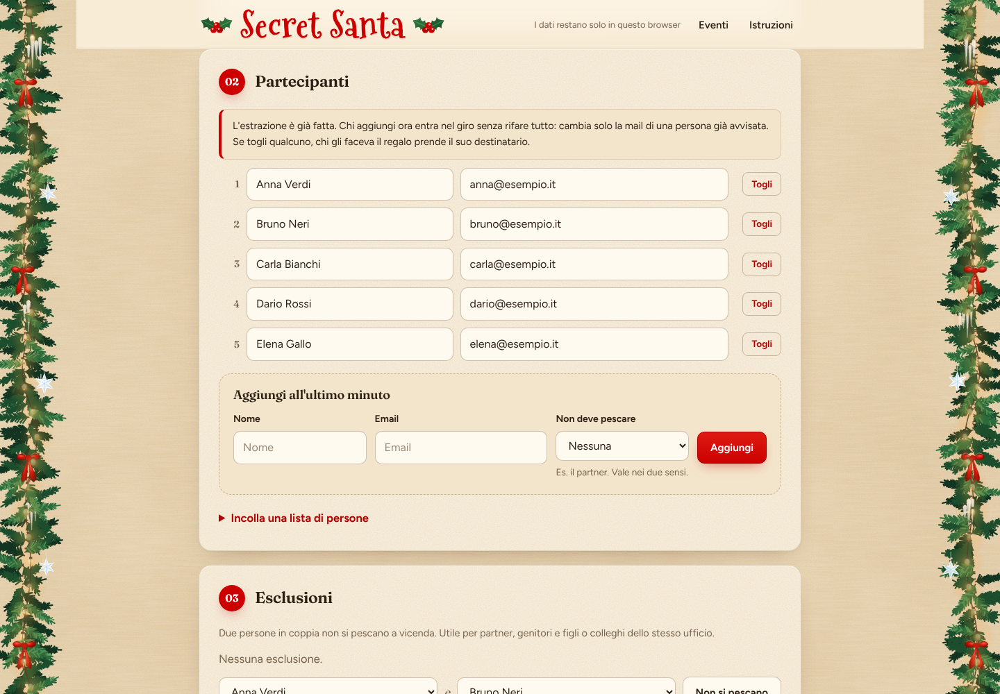
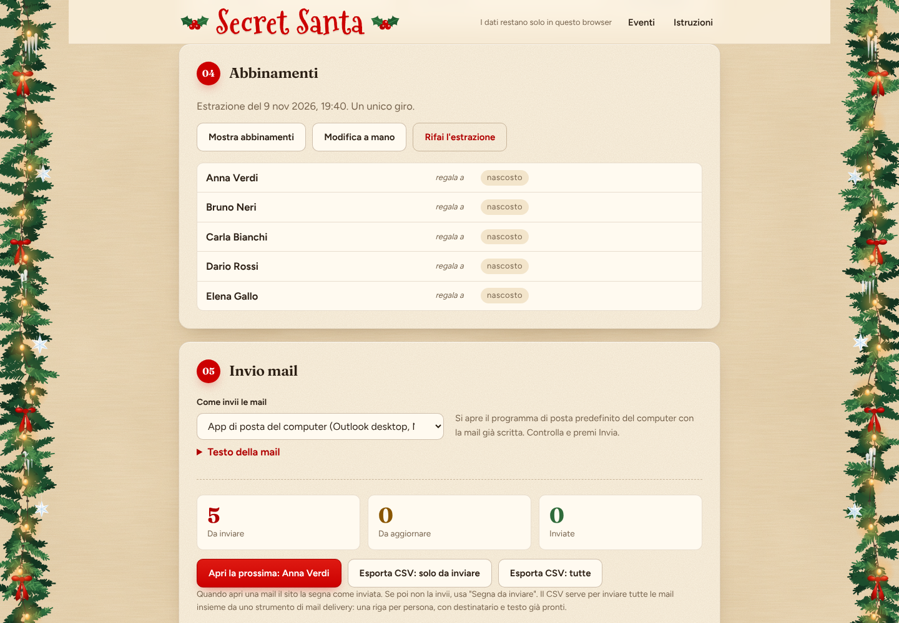
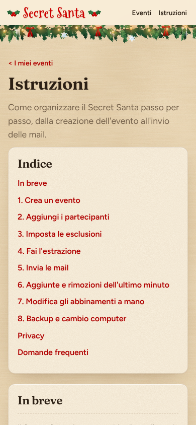

# Secret Santa

Sito per organizzare uno scambio di regali Secret Santa: estrazione, esclusioni, aggiunte dell'ultimo minuto, modifica manuale degli abbinamenti e invio delle mail dal tuo account.

È un sito statico su GitHub Pages. Non ha server, database o account. Nomi, email e abbinamenti restano solo nel browser di chi organizza.

**Sito:** https://mattiabaldinazzo.github.io/secretsanta/



## Indice

- [Funzioni](#funzioni)
- [Come si usa](#come-si-usa)
- [Come funziona l'estrazione](#come-funziona-lestrazione)
- [Aggiunte e rimozioni dell'ultimo minuto](#aggiunte-e-rimozioni-dellultimo-minuto)
- [Invio delle mail](#invio-delle-mail)
- [Privacy e sicurezza](#privacy-e-sicurezza)
- [Pubblicazione su GitHub Pages](#pubblicazione-su-github-pages)
- [Sviluppo](#sviluppo)
- [Struttura del progetto](#struttura-del-progetto)
- [Design](#design)
- [Decorazioni](#decorazioni)
- [Limiti noti](#limiti-noti)

## Funzioni

| Funzione | Cosa fa |
| --- | --- |
| Estrazione | Crea un unico giro in cui ognuno fa un regalo e ne riceve uno. Nessuna coppia si scambia il regalo. |
| Esclusioni | Due persone non si pescano a vicenda (partner, familiari, colleghi). |
| Aggiunte dell'ultimo minuto | La persona nuova entra nel giro già estratto. Va rifatta una sola mail esistente. |
| Rimozioni dell'ultimo minuto | Il giro si ricollega da solo. Va rifatta una sola mail, al massimo due. |
| Modifica manuale | L'admin cambia gli abbinamenti e il sito controlla in tempo reale che siano validi. |
| Invio mail | Programma di posta del computer, Outlook.com, Outlook Microsoft 365 oppure CSV per uno strumento di mail delivery. |
| Stato delle mail | Da inviare, da aggiornare, inviata. Il sito sa quali mail sono cambiate dopo l'invio. |
| Testo personalizzabile | Oggetto e testo con segnaposto: `{nome}`, `{destinatario}`, `{evento}`, `{data}`, `{luogo}`, `{budget}`, `{messaggio}`, `{organizzatore}`. |
| Backup | File JSON, anche cifrato con password (AES-256-GCM). Serve per cambiare computer o browser. |
| Istruzioni | Guida completa dentro il sito, nella pagina "Istruzioni". |

## Come si usa

La guida completa è nella pagina **Istruzioni** del sito. In sintesi:

1. **Nuovo evento.** Compila nome, organizzatore, data, luogo, budget e messaggio. Tutti i campi sono facoltativi e si salvano da soli.
2. **Partecipanti.** Aggiungili uno alla volta oppure incolla una lista, una persona per riga:
   ```
   Mario Rossi; mario@esempio.it
   Giulia Bianchi <giulia@esempio.it>
   Luca, luca@esempio.it
   ```
   Servono almeno 3 persone e ogni nome deve essere unico.
3. **Esclusioni.** Scegli due persone e clicca "Non si pescano".
4. **Estrazione.** Clicca "Fai l'estrazione". Gli abbinamenti restano nascosti finché non clicchi "Mostra abbinamenti".
5. **Mail.** Scegli come inviare e clicca "Apri la prossima" per ogni persona, oppure esporta il CSV.
6. **Backup.** Scaricalo subito dopo l'estrazione.



## Come funziona l'estrazione

Il codice è in `assets/js/draw.js`.

1. **Giro unico.** Una ricerca con backtracking costruisce un ciclo che tocca tutti i partecipanti: A regala a B, B a C, e così via fino a tornare ad A. L'ordine è casuale e le esclusioni vengono rispettate. Per evitare blocchi con molti vincoli la ricerca si ferma dopo 200.000 passi.
2. **Ripiego.** Se un giro unico è impossibile, un abbinamento bipartito (algoritmo di Kuhn, con ordine casuale) trova una soluzione valida con più giri, se esiste. Il sito avvisa che i giri sono più di uno.
3. **Nessuna soluzione.** Se nemmeno il ripiego trova una soluzione, il sito chiede di togliere qualche esclusione.

La casualità viene da `crypto.getRandomValues`, il generatore crittografico del browser.

Perché un giro unico:

- nessuna coppia si fa il regalo a vicenda;
- non ci sono gruppetti chiusi, quindi un'aggiunta o una rimozione tocca pochissime persone.

Prima di salvare una modifica manuale, la validazione controlla:

- **Errori** (bloccano il salvataggio): regalo a se stessi, persona che riceve due regali, persona senza destinatario o senza regalo.
- **Avvisi** (richiedono una conferma): esclusione violata, coppia che si scambia il regalo.

## Aggiunte e rimozioni dell'ultimo minuto

**Aggiunta.** Il sito sceglie a caso una persona G il cui abbinamento può essere spezzato rispettando le esclusioni. Se G regalava a R:

```
prima:  G -> R
dopo:   G -> Nuovo -> R
```

Va inviata la mail del nuovo arrivato e va aggiornata solo quella di G. Tutti gli altri abbinamenti restano invariati e il giro resta unico.

**Rimozione.** Se G regalava alla persona X che esce, e X regalava a R:

```
prima:  G -> X -> R
dopo:   G -> R
```

Se G non può regalare a R per un'esclusione, G prende il destinatario di un'altra persona H, e H regala a R. In quel caso cambiano 2 mail.

Se il sito non trova una soluzione, lascia la persona senza abbinamento e chiede di correggere a mano o rifare l'estrazione.

## Invio delle mail

Il sito non invia mail da solo: non ha un server. Prepara ogni mail e la apre nel programma che scegli. Sei tu a premere Invia.

| Modalità | Come funziona |
| --- | --- |
| App di posta del computer | Link `mailto:`. Si apre il programma predefinito (Outlook desktop, Mail, Thunderbird) con destinatario, oggetto e testo compilati. |
| Outlook.com | Si apre `outlook.live.com` in una nuova scheda con la mail compilata. Per account personali. |
| Outlook Microsoft 365 | Si apre `outlook.office.com` con la mail compilata. Per account di lavoro o scuola. |
| Strumento di mail delivery | Esporti un CSV e lo importi in qualsiasi servizio per newsletter o invii massivi. |

### Stato delle mail

Quando apri una mail il sito salva un'impronta (hash) del testo. Se dopo l'invio cambia qualcosa (destinatario, data, luogo, testo), l'impronta non corrisponde più e la mail diventa **da aggiornare**. Così, dopo un'aggiunta all'ultimo minuto, vedi subito le 2 mail da inviare.

### CSV per strumenti di mail delivery

- Codifica UTF-8 con BOM, separatore punto e virgola, tutti i campi tra virgolette.
- Una riga per partecipante.
- Puoi esportare solo le mail da inviare o aggiornare, oppure tutte.

| Colonna | Contenuto |
| --- | --- |
| `email` | indirizzo del partecipante |
| `nome` | nome del partecipante |
| `destinatario` | persona a cui fa il regalo |
| `evento`, `data`, `luogo`, `budget`, `messaggio`, `organizzatore` | dettagli dell'evento |
| `oggetto` | oggetto già completo |
| `testo` | testo della mail già completo |

Nello strumento hai due strade:

- collegare le colonne ai campi personalizzati e usarli nel modello della mail;
- usare direttamente le colonne `oggetto` e `testo`.

Il CSV contiene gli abbinamenti in chiaro: cancellalo dopo l'invio, dal computer e dallo strumento.

## Privacy e sicurezza

| Rischio | Protezione |
| --- | --- |
| Dati dei partecipanti pubblici su GitHub | Il repository contiene solo codice. I dati vivono nel `localStorage` del browser. Il `.gitignore` esclude anche CSV e backup. |
| Dati inviati a server esterni | La Content Security Policy (`connect-src 'none'`, `default-src 'none'`) impedisce al sito qualsiasi richiesta di rete. |
| Tracciamento | Niente analytics, cookie, font o script esterni. I font sono ospitati nel sito stesso (`font-src 'self'`). |
| Indicizzazione | `noindex, nofollow` e nessun referrer inviato. |
| Furto del backup | Backup facoltativamente cifrato: AES-256-GCM con chiave derivata da PBKDF2-SHA-256 (310.000 iterazioni). |
| Codice malevolo nei dati | L'interfaccia inserisce i dati solo come testo, mai come HTML. |
| L'organizzatore vede gli abbinamenti | Sono nascosti di default. Chi organizza e partecipa non deve cliccare "Mostra abbinamenti". |

Da sapere: chi apre il sito su un altro browser non vede nulla, perché ogni browser ha i suoi dati. È voluto. Per spostare un evento usa il backup.

## Pubblicazione su GitHub Pages

Il sito non richiede build: GitHub Pages serve i file così come sono.

1. Apri **Settings > Pages** nel repository.
2. In **Build and deployment** scegli **Source: Deploy from a branch**.
3. Seleziona il branch `main` e la cartella `/ (root)`, poi clicca **Save**.
4. Dopo circa un minuto il sito è online su `https://mattiabaldinazzo.github.io/secretsanta/`.

Ogni push su `main` aggiorna il sito automaticamente. Il file `.nojekyll` disattiva Jekyll, quindi tutti i file vengono pubblicati così come sono.

## Sviluppo

Servono Node 20 o superiore (solo per i test) e Python 3 (per il server locale).

```
npm test     # 22 test della logica con node --test
npm start    # server locale su http://localhost:8080
```

Serve un server locale: i moduli JavaScript non funzionano aprendo `index.html` come file.

GitHub Actions esegue i test a ogni push (`.github/workflows/test.yml`).

## Struttura del progetto

```
index.html               pagina unica, con la Content Security Policy
assets/style.css         stile: carta crema, colore primario #CC0000, tema chiaro e scuro, ghirlande
assets/js/app.js         interfaccia: home, evento, routing
assets/js/draw.js        estrazione, validazione, aggiunte e rimozioni
assets/js/mail.js        testo delle mail, link mailto e Outlook, CSV
assets/js/store.js       salvataggio locale, backup e cifratura
assets/js/guide.js       pagina Istruzioni
assets/js/garland.js     ghirlande natalizie in SVG
assets/fonts/            font (Mountains of Christmas, Fraunces, Figtree) e licenze
tests/                   test con node --test
docs/                    screenshot per questo README
```

Non ci sono dipendenze esterne né passaggi di build.

## Design

- **Sfondo:** carta ruvida color crema caldo (`#EFDDBD`), con grana, fibre e macchie generate in SVG dentro il CSS, senza immagini da scaricare. In tema scuro diventa carta color caffè.
- **Schede:** carta più chiara con angoli arrotondati e ombre morbide.
- **Colore primario:** `#CC0000`, per pulsanti, numeri delle sezioni e logo.
- **Font:**
  - [Fraunces](https://fonts.google.com/specimen/Fraunces) per i titoli: un serif morbido che richiama la carta stampata;
  - [Figtree](https://fonts.google.com/specimen/Figtree) per il testo: un sans moderno e leggibile;
  - [Mountains of Christmas](https://fonts.google.com/specimen/Mountains+of+Christmas) per il logo.
- **Licenze:** Fraunces e Figtree sono sotto SIL Open Font License 1.1, Mountains of Christmas sotto Apache 2.0. Tutti i font sono ospitati nel sito (`assets/fonts/`, con le licenze).

## Decorazioni

In alto c'è il logo "Secret Santa" con un rametto di agrifoglio, scritto con il font natalizio [Mountains of Christmas](https://fonts.google.com/specimen/Mountains+of+Christmas) (licenza Apache 2.0, testo in `assets/fonts/`).

I bordi verticali della pagina hanno ghirlande di pino disegnate in SVG da `assets/js/garland.js`:

- rami di pino su tre livelli di profondità;
- fiocchi di velluto rosso `#CC0000`;
- stalattiti di ghiaccio appese al centro dei rami e stelle di cristallo;
- lucine LED a luce calda, in due gruppi che si alternano con un ritmo costante di 3,2 secondi.

Il disegno usa numeri casuali a seme fisso, quindi è sempre uguale. Si adatta allo schermo:

| Larghezza schermo | Ghirlanda |
| --- | --- |
| 1100 px e oltre | 110 px per lato |
| 720 - 1099 px | 64 px per lato |
| sotto 720 px (telefono) | striscia orizzontale sotto l'intestazione |

Chi ha attivato "riduci movimento" nel sistema operativo vede le luci accese fisse.



## Limiti noti

- **Niente lista dei desideri né messaggi anonimi.** Servirebbe un database condiviso tra i partecipanti, in contrasto con l'obiettivo di non avere server.
- **Link mailto lunghi.** Alcuni programmi di posta tagliano i link molto lunghi. Il sito avvisa sopra i 1900 caratteri, e "Copia" resta sempre disponibile.
- **Link di compilazione di Outlook sul web.** Microsoft non li documenta in modo ufficiale e potrebbe cambiarli.
- **Stato "inviata".** Il sito segna la mail come inviata quando la apri, perché non può sapere se hai premuto Invia. Se non la invii, usa "Segna da inviare".
